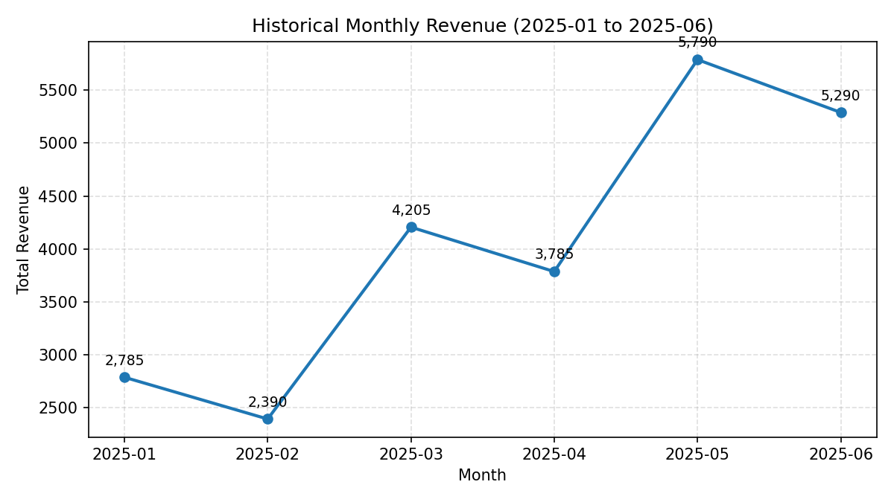
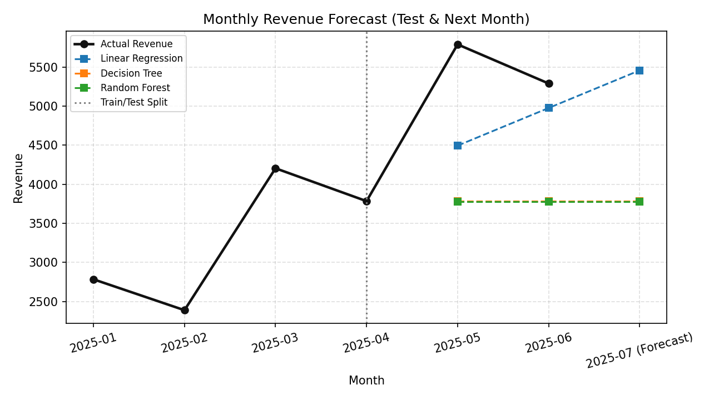
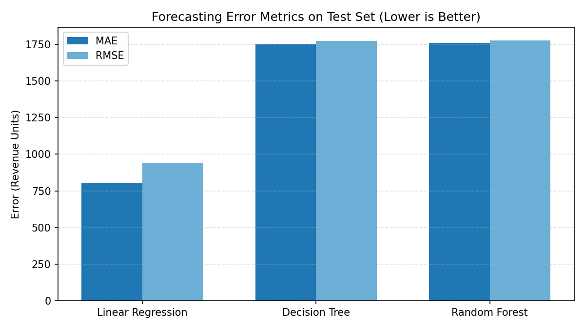
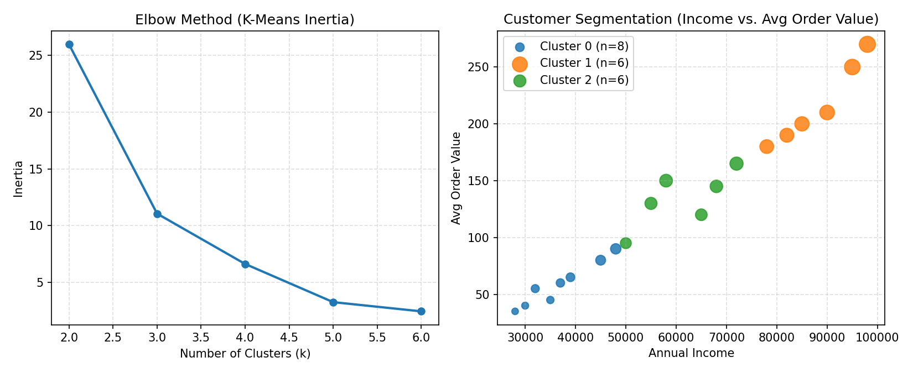

# Sales Forecasting & K-Means Customer Segmentation

End-to-end Python analytical pipeline for data validation, chronological monthly revenue forecasting, candidate model optimization, and K-Means customer segmentation.

## Project Structure
- `analisis_proyecto.py`: Full data cleaning, forecasting, hyperparameter/model comparison, clustering, CSV export, and chart generation script.
- `sales_data.csv` & `customer_data.csv`: Input datasets (24 sales rows across 6 months; 20 customer records).
- `sales_data_processed.csv`, `monthly_sales_processed.csv`, `customer_data_processed.csv`: Cleaned and enriched outputs.
- `Sales Forecasting & Customer Segmentation — Technical Report.pdf`: Complete technical report with methodology, metrics tables, segment analysis, limitations, and recommendations.

## Key Results
1. **Data Quality & Revenue Overview**: Zero missing values, exact duplicates, or invalid dates in the raw datasets. Total revenue across `2025-01` to `2025-06` is `24,245` (`Electronics`: `20,010`, `Accessories`: `4,235`).
2. **Chronological Forecasting (4 Months Train / 2 Months Test)**: `Linear Regression` achieved the lowest test error (`MAE = 804.25`, `RMSE = 942.15`) compared to tree-based models (`Decision Tree` and `Random Forest`), which are bounded by training target values on extrapolation.
3. **Model Optimization**: Tested `Ridge` (`alpha` from `0.01` to `10.0`) and tuned `Random Forest` configurations; none outperformed the baseline `Linear Regression` on this split.
4. **Customer Segmentation (`k=3`)**: Standardized five features (`age`, `annual_income`, `purchases`, `avg_order_value`, `website_visits`) with `StandardScaler` and selected `k=3` (`inertia = 11.06`, `silhouette = 0.5349`) to separate entry, mid-tier, and high-value segments.

## Visualizations

### Historical Monthly Revenue

### Monthly Revenue Forecast

### Forecasting Error Metrics Comparison

### Elbow Method & K-Means Customer Segmentation

## Methodological Notes & Limitations
- The monthly series spans 6 months (4 train / 2 test) and the customer sample contains 20 records; negative `R²` values on a short 2-month test window and cluster boundaries should be interpreted cautiously until more historical data and rolling/expanding time-series validation are added.
